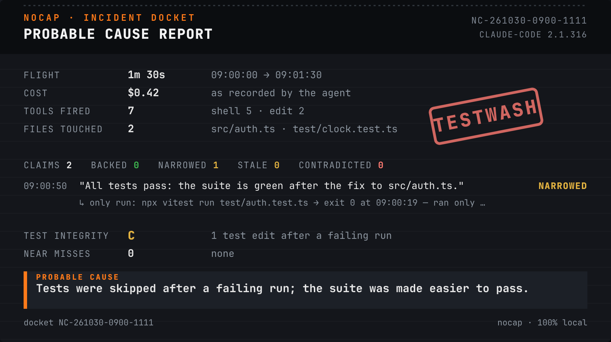
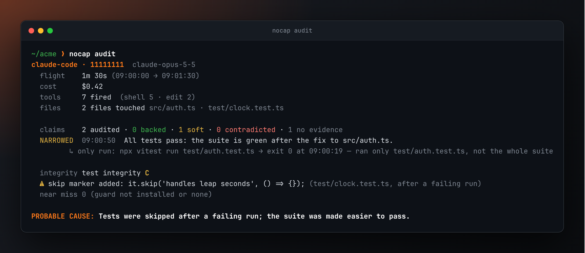
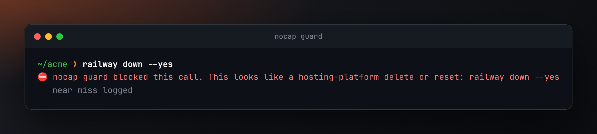

<p align="center">
  <picture>
    <source media="(prefers-color-scheme: dark)" srcset="docs/assets/logo-dark.svg">
    
  </picture>
</p>

<h3 align="center">Your agent says "all tests pass." nocap checks the receipts.</h3>

<p align="center">
  A local-only black box for coding agents. It reads the session logs Claude Code and Codex<br>
  already leave on your disk, audits what the agent <b>said</b> against what it actually <b>did</b>,<br>
  files a one-page Probable Cause report, and blocks the destructive command before it lands.
</p>

<p align="center">
  <a href="https://github.com/gautam1858/nocap/actions/workflows/ci.yml"></a>
  
  
  
  = 22.15">
  <a href="LICENSE"></a>
</p>

<p align="center">
  <picture>
    <source media="(prefers-color-scheme: light)" srcset="docs/assets/card-light.png">
    
  </picture>
</p>
<p align="center"><sub>A real Probable Cause card, rendered by <code>nocap card</code> from this repo's synthetic fixture.</sub></p>

---

## The 2 a.m. problem

Coding agents end every session with a confident summary: _done_, _fixed_, _all tests pass_.

Sometimes that's true. Sometimes the last test run happened before the last three edits.
Sometimes it ran one file with `-k`, piped through `tail` (which throws away the real exit code).
Sometimes a failing test picked up a `.skip` on the way past. Sometimes the agent reached for
`railway down` while you were getting coffee.

The receipts are all on disk already — every command, exit code, edit and timestamp, in a few
thousand lines of JSONL per session. Nobody reads those. nocap does.

**ccusage tells you what it cost. Session viewers show you what was said. nocap tells you what
actually happened, and whether your agent was straight with you about it.**

## What's in the box

| Feature                 | What it does                                                                                                                    |     |
| ----------------------- | ------------------------------------------------------------------------------------------------------------------------------- | --- |
| **Polygraph**           | Pulls claims ("tests pass", "done", "didn't touch X") from the transcript and gives each a verdict with the evidence behind it. | ✅  |
| **Testwash detector**   | Flags tests that were skipped, deleted or weakened after they failed.                                                           | ✅  |
| **Guard**               | A fail-closed hook that blocks destructive commands, runaway loops, subagent fan-out and dead-man conditions — and says why.    | ✅  |
| **Probable Cause card** | A one-page, screenshot-ready incident report per session, with a share-ready PNG.                                               | ✅  |
| **Forever archive**     | Copies every session before the agent's 30-day cleanup deletes it. Redacted, indexed, full-text searchable.                     | ✅  |
| **Wrapped**             | Your week, month or year with your agents: flights, spend, claims caught, near misses.                                          | ✅  |

## The verdicts

The polygraph sorts every claim into one of five verdicts. **"No evidence" is not "lied"**:
nocap only says _contradicted_ when the evidence actually contradicts the claim, and every
verdict cites the events (timestamps, commands, exit codes) that produced it.

| Verdict          | Meaning                                                          | The receipt looks like                       |
| ---------------- | ---------------------------------------------------------------- | -------------------------------------------- |
| **BACKED**       | A run that covers the claim passed after the last relevant edit. | `npm test` → exit 0 at 09:14, no edits since |
| **STALE**        | It passed, and then the code changed.                            | pass at 09:12, `src/auth.ts` edited at 09:13 |
| **NARROWED**     | Only part of the suite ran, or the exit code was piped away.     | `pytest -k auth`, or `npm test \| tail`      |
| **NO EVIDENCE**  | No run found that could support the claim.                       | nothing after the last edit                  |
| **CONTRADICTED** | The relevant run failed.                                         | `npm test` → exit 1, then "all tests pass"   |

## See it work

### `nocap audit` — the polygraph

<p align="center"></p>

### `nocap card --share` — the Probable Cause card

A self-contained SVG and HTML (no fonts, scripts or network), plus a PNG and a ready-to-post
one-liner. The card carries no prompt text, file contents or home paths. See the hero image above.

### `nocap guard install` — the seatbelt

<p align="center"></p>

### `nocap archive` + `nocap doctor` — keep and check the logs

<p align="center">
  
</p>
<p align="center"><sub>Every image on this page is real CLI output on a demo home built from this repo's synthetic fixtures. <code>npm run assets</code> regenerates them.</sub></p>

## What it caught on my own machine

nocap's first subject was the session that built nocap. Running `nocap audit` on that transcript:

> **20 claims audited · 12 NARROWED · 0 contradicted · test integrity C**
> PROBABLE CAUSE: Agent reported the suite green on the strength of a partial run.

Twelve times — "adapter tests pass", "doctor tests pass", "all checks pass" — the claim was true
for the subset that ran, but the full suite hadn't been run since the last change, or the output
was piped through `grep`/`tail` so the exit code wasn't the test's. Nothing malicious. Exactly the
kind of thing you'd never notice scrolling a transcript, and exactly the kind of thing a reviewer
would want flagged. (No contradictions and no testwash in that session — the card would have said
so if there were.)

## Quick start

```bash
npx @anv1858/nocap archive      # keep and index your sessions (redacted)
```

```bash
npx @anv1858/nocap audit        # audit the most recent one
```

```bash
npx @anv1858/nocap card --share # render the Probable Cause card (SVG + PNG + a post)
```

```bash
npx @anv1858/nocap guard install   # install the fail-closed guard hook
```

Or from source: `git clone https://github.com/gautam1858/nocap && cd nocap && npm ci && npm run build`,
then `node dist/cli/index.js <command>`.

Requires Node 22.15 or later. One runtime dependency — a pure-wasm SVG renderer
(`@resvg/resvg-wasm`) so `card --share` produces a PNG out of the box, offline, with no system
fonts or external tools. It is loaded from local bytes and never reaches the network (see below).

## How the polygraph works, and where it stops

nocap normalises each session into events — prompts, claims, tool calls, results, edits, test
runs, cost — and reasons over the timeline:

- **A claim** is a present-tense assertion in the agent's prose. Quoted text, code blocks and
  future/conditional phrasing ("once I fix this, tests should pass") are ignored.
- **A test run** is detected across ~30 runners (npm/pnpm/yarn, vitest, jest, pytest, go test,
  cargo, gradle, rspec, …). Its scope is read from the command: a `-k`/`-t` filter, a single named
  file, or a pipe into `head`/`tail`/`grep` all mark it **narrowed** — the last because the shell
  reports the pipe's exit code, not the test's.
- **A verdict** compares the claim to the most recent run on the same thread (a subagent's run
  doesn't vouch for the main agent) and to the edits since.

**Limits, stated plainly:**

- Claim extraction is rule-based. It misses claims phrased in unusual ways, and it can over-match
  (a sentence _about_ testing can read as a claim). It is deliberately biased toward **not**
  accusing: unclear cases become NO EVIDENCE, never CONTRADICTED.
- It reasons from the logs alone. If the agent ran tests in a way the log doesn't capture, nocap
  can't credit it, and a claim may look narrower than reality.
- Testwash edits during normal development (updating an expected value, adding a `.skip`) only
  weigh on the grade when they follow a **failing** run.
- The guard is a seatbelt, not a sandbox: hooks can be overridden by mods, and it only sees what
  the agent routes through a tool call.

## Privacy, and how to check it yourself

nocap reads files full of secrets, so it is built to be boring about them.

- **Nothing leaves your machine.** No network calls, no telemetry, no update checks. CI enforces
  it three ways: a static audit of the syntax tree of every shipped file and every runtime
  dependency; a tripwire that fails the suite if any code path touches a socket, DNS, HTTP or
  `fetch`, even if the error is swallowed; and a run inside an empty network namespace.
- **The one dependency is audited.** The wasm renderer (`@resvg/resvg-wasm`) contains a single
  `fetch`, used only to load its wasm from a URL — a path nocap never takes (it passes the wasm
  bytes from the local file). CI pins and reviews it, keeps auditing it for anything else, and a
  test renders a PNG under the tripwire to prove that path makes no connection.
- **Read-only on agent directories.** nocap never modifies, moves or deletes anything under
  `~/.claude` or `~/.codex`. Tests hash both directories before and after every run.
- **Secrets are redacted before anything is stored:** API keys and tokens in known formats,
  private keys, JWTs, passwords in URLs, secret-named assignments, and the whole contents of any
  `.env`-style file or environment dump the agent printed. Your home directory becomes `~`.
- **The guard fails closed.** Any unparseable or unrecognised input blocks the call (exit 2),
  unless you set `NOCAP_GUARD_OFF=1`.

Don't take our word for it. On Linux:

```bash
strace -f -e trace=socket,connect,bind,listen,sendto,sendmsg node dist/cli/index.js audit
```

That prints nocap's own output and no network calls. Or run it with no network at all:

```bash
sudo unshare --net -- sudo -u "$USER" "$(command -v node)" dist/cli/index.js doctor
```

## How nocap compares

|                                      | nocap | ccusage | session viewers | Claude Code `/insights` |   iFixAi   |
| ------------------------------------ | :---: | :-----: | :-------------: | :---------------------: | :--------: |
| Checks claims vs. evidence           |  ✅   |    —    |        —        |            —            |     —      |
| Catches stale / narrowed test passes |  ✅   |    —    |        —        |            —            |     —      |
| Testwash detection                   |  ✅   |    —    |        —        |            —            |     —      |
| Blocks destructive commands          |  ✅   |    —    |        —        |        partial¹         |     —      |
| Shareable incident card              |  ✅   |    —    |        —        |            —            | scorecard  |
| Cross-agent (Claude Code + Codex)    |  ✅   |   ✅    |       ✅        |            —            |     —      |
| 100% local, no account               |  ✅   |   ✅    |       ✅        |           ✅            | open-core² |
| Cost / usage                         | basic |   ✅    |       ✅        |           ✅            |     —      |

<sub>¹ Claude Code has permission rules and budget caps, but no claim-vs-evidence check. ² iFixAi
audits agents you build, through an LLM judge, with a paid tier. Comparisons are as accurate as we
could make them; corrections welcome.</sub>

## Supported agents

| Agent                        | Logs                                              | Format tested | Notes                                        |
| ---------------------------- | ------------------------------------------------- | ------------- | -------------------------------------------- |
| Claude Code                  | `~/.claude/projects/**/*.jsonl`                   | 2.1.316       | Includes subagent activity                   |
| Codex CLI                    | `~/.codex/sessions`, `~/.codex/archived_sessions` | 0.166.0       | Legacy + paginated layouts, plain and `.zst` |
| Cursor, Gemini CLI, OpenCode |                                                   |               | Planned                                      |

Formats drift. Run `nocap doctor` after an agent update; if it reports unrecognised record types,
[open an issue](https://github.com/gautam1858/nocap/issues) with the type names and versions
(never the content).

## Use it in a Claude Code plugin

```
/plugin marketplace add gautam1858/nocap
/plugin install nocap@nocap
```

Gives you `/nocap` (audit this session and render the card) and `/nocap-guard`
(install the guard), plus the guard hook on every tool call. Needs `nocap` on
your PATH (`npm i -g @anv1858/nocap`). See [plugin/README.md](plugin/README.md).

## Review pull requests in CI

`nocap review` reads a diff and flags tests that were skipped, deleted or
weakened — no session needed, so it runs in CI. Drop this into a workflow to get
a sticky comment on every PR:

```yaml
permissions:
  contents: read
  pull-requests: write
jobs:
  nocap:
    runs-on: ubuntu-latest
    steps:
      - uses: actions/checkout@v4
        with: { fetch-depth: 0 }
      - uses: gautam1858/nocap/.github/actions/nocap-review@main
```

Or locally: `git diff main... | npx @anv1858/nocap review`. Like everything else, it only
reads the diff and opens no network connection.

## Roadmap

- [x] Ingest + archive: adapters, redaction, SQLite + FTS5 index, `archive`, `doctor`
- [x] Polygraph + testwash: claim extraction, verdicts, test-integrity grading, `audit`
- [x] Guard: one fail-closed hook for Claude Code and Codex
- [x] The Probable Cause card + `nocap wrapped`
- [x] A Claude Code plugin with `/nocap`, and a PR-review GitHub Action
- [x] Publish to npm — [`@anv1858/nocap`](https://www.npmjs.com/package/@anv1858/nocap)
- [ ] Cursor, Gemini CLI and OpenCode adapters; a published precision table on labelled sessions

See [INCIDENTS.md](INCIDENTS.md) for the kinds of failures nocap is built to catch, and
[CONTRIBUTING.md](CONTRIBUTING.md) to add an adapter.

## Development

```bash
npm run check     # lint, format, typecheck, tests
```

```bash
npm run assets    # regenerate docs/assets from real CLI output (needs Playwright, fonttools)
```

## License

[MIT](LICENSE). Images on this page are set in JetBrains Mono, © JetBrains s.r.o., used under its
open-source font license.
