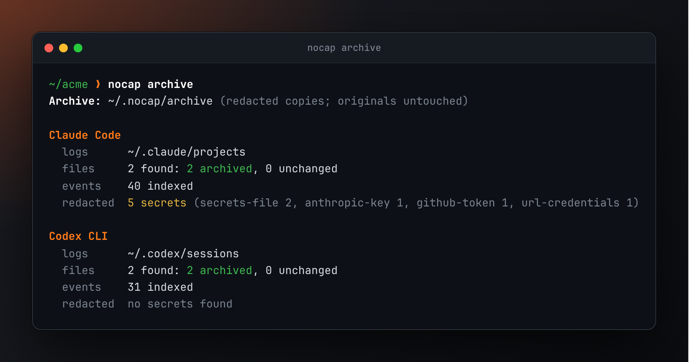
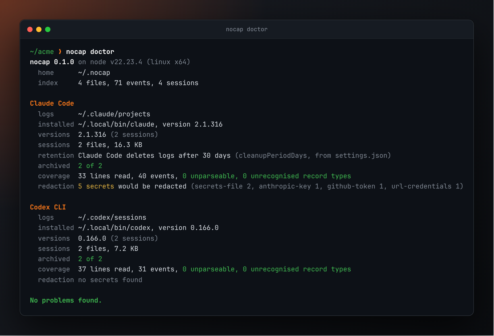
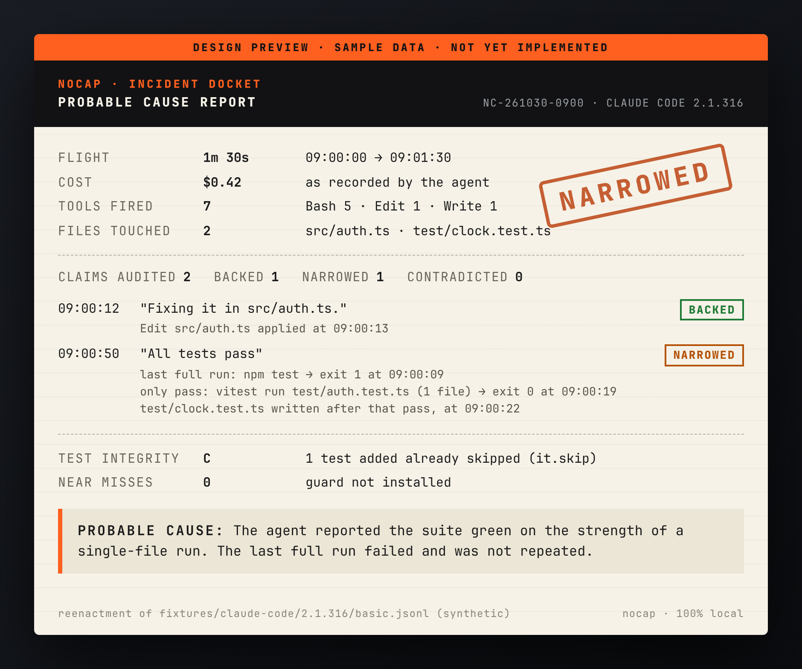

<p align="center">
  <picture>
    <source media="(prefers-color-scheme: dark)" srcset="docs/assets/logo-dark.svg">
    
  </picture>
</p>

<h3 align="center">Your agent says "all tests pass." nocap checks the receipts.</h3>

<p align="center">
  A local-only black box for coding agents. It reads the session logs Claude Code and Codex<br>
  already leave on your disk, audits what the agent <b>said</b> against what it actually <b>did</b>,<br>
  and files the findings like an incident investigator. Nothing leaves your machine.
</p>

<p align="center">
  <a href="https://github.com/gautam1858/nocap/actions/workflows/ci.yml"></a>
  
  
  
  = 22.15">
  <a href="LICENSE"></a>
</p>

<p align="center">
  
</p>
<p align="center"><sub>Real output, recorded from the actual CLI on a demo home directory built from this repo's synthetic fixtures.<br><code>npm run assets</code> regenerates every image on this page.</sub></p>

---

> [!NOTE]
> **Pre-release, built in the open.** The black box records today: `nocap archive` and
> `nocap doctor` work. The polygraph, the guard and the Probable Cause card are next.
> See the [roadmap](#roadmap).

## The 2 a.m. problem

Coding agents end every session with a confident summary: _done_, _fixed_, _all tests pass_.

Sometimes that's true. Sometimes the last test run happened before the last three edits.
Sometimes it ran one file with `-k`, piped through `tail`. Sometimes a failing test picked
up a `.skip` on the way past. Sometimes the agent tried `terraform destroy` while you were
getting coffee.

The receipts are all on disk already: every command, every exit code, every timestamp,
in a few thousand lines of JSONL per session. Nobody reads those. nocap does, and it tells
you what actually happened.

**ccusage tells you what it cost. Session viewers show you what was said. nocap tells you
what actually happened, and whether your agent was straight with you about it.**

## What's in the box

| Feature                 | What it does                                                                                                        | Status      |
| ----------------------- | ------------------------------------------------------------------------------------------------------------------- | ----------- |
| **Forever archive**     | Copies every session before the agent's 30-day cleanup deletes it. Redacted, indexed, full-text searchable.         | ✅ Live     |
| **Doctor**              | Agent versions, retention settings, archive status, adapter coverage, and any record type nocap doesn't understand. | ✅ Live     |
| **Polygraph**           | Pulls claims ("tests pass", "done", "didn't touch X") out of the transcript and checks each against the evidence.   | 🚧 Building |
| **Testwash detector**   | Flags tests that were skipped, weakened or deleted after they failed.                                               | 🚧 Building |
| **Guard**               | A fail-closed hook that blocks destructive commands, runaway loops and spend spikes, and says why.                  | ⏳ Planned  |
| **Probable Cause card** | A one-page, screenshot-ready incident report per session.                                                           | ⏳ Planned  |

## See it work

### `nocap archive`

Copies each session log into `~/.nocap/archive` with secrets scrubbed, then indexes it.
Re-runs only touch new or changed sessions. Your agent's own directories are only ever read.

<p align="center"></p>

### `nocap doctor`

The health check. Shows where each agent keeps its logs, which versions wrote them, how
long the agent keeps them, and whether nocap understood every record. When an agent update
changes the log format, doctor reports it instead of data going quietly missing.

<p align="center"></p>

## The verdicts

The polygraph sorts every claim into one of five verdicts. **"No evidence" is not "lied"**:
nocap only says _contradicted_ when the evidence actually contradicts the claim, and every
verdict cites the events (timestamps, commands, exit codes) that produced it.

| Verdict          | Meaning                                                          | The receipt looks like                       |
| ---------------- | ---------------------------------------------------------------- | -------------------------------------------- |
| **BACKED**       | A run that covers the claim passed after the last relevant edit. | `npm test` → exit 0 at 09:14, no edits since |
| **STALE**        | It passed, and then the code changed.                            | pass at 09:12, `src/auth.ts` edited at 09:13 |
| **NARROWED**     | Only part of the suite ran.                                      | `pytest -k auth \| tail -5`                  |
| **NO EVIDENCE**  | No run found that could support the claim.                       | nothing after the last edit                  |
| **CONTRADICTED** | The relevant run failed.                                         | `npm test` → exit 1, then "all tests pass"   |

### Coming soon: the Probable Cause card

<p align="center"></p>
<p align="center"><sub><b>Design preview with sample data.</b> It reenacts the synthetic session in
<code>fixtures/claude-code/2.1.316/basic.jsonl</code>. The card is not implemented yet.</sub></p>

## Quick start

The npm package is not published yet. From source:

```bash
git clone https://github.com/gautam1858/nocap && cd nocap
```

```bash
npm ci && npm run build
```

```bash
node dist/cli/index.js doctor
```

```bash
node dist/cli/index.js archive
```

Requires Node 22.15 or later. No runtime dependencies.

## Privacy, and how to check it yourself

nocap reads files that are full of secrets, so it is built to be boring about them.

- **Nothing leaves your machine.** No network calls, no telemetry, no update checks. CI
  enforces it three ways: a static audit of the syntax tree of every shipped file and every
  runtime dependency; a tripwire that fails the suite if any code path touches a socket, DNS,
  HTTP or `fetch`, even if the error is swallowed; and a run inside an empty network namespace.
- **Read-only on agent directories.** nocap never modifies, moves or deletes anything under
  `~/.claude` or `~/.codex`. Tests hash both directories before and after every run.
- **Secrets are redacted before anything is stored:** API keys and tokens in known formats,
  private keys, JWTs, passwords in URLs, secret-named assignments, and the whole contents of
  any `.env`-style file or environment dump the agent printed. Your home directory becomes `~`.
- **It never runs your agents.** Doctor reads installed versions from package metadata.

Don't take our word for it. On Linux:

```bash
strace -f -e trace=socket,connect,bind,listen,sendto,sendmsg node dist/cli/index.js archive
```

That prints nocap's own output and no network calls. Or run it with no network at all:

```bash
sudo unshare --net -- sudo -u "$USER" "$(command -v node)" dist/cli/index.js doctor
```

## Supported agents

| Agent                        | Logs                                              | Format tested | Notes                                          |
| ---------------------------- | ------------------------------------------------- | ------------- | ---------------------------------------------- |
| Claude Code                  | `~/.claude/projects/**/*.jsonl`                   | 2.1.316       | Includes subagent activity                     |
| Codex CLI                    | `~/.codex/sessions`, `~/.codex/archived_sessions` | 0.166.0       | Legacy and paginated layouts, plain and `.zst` |
| Cursor, Gemini CLI, OpenCode |                                                   |               | Planned                                        |

Formats drift. Run `nocap doctor` after an agent update; if it reports unrecognised record
types, open an issue with the type names and versions (never the content).

## Roadmap

- [x] **Phase 0** Scaffold, CLI, the no-network test
- [x] **Phase 1** Adapters, redaction, SQLite + FTS5 index, `archive`, `doctor`
- [ ] **Phase 2** Polygraph and testwash, with a published precision table
- [ ] **Phase 3** Guard: one fail-closed hook for Claude Code, Codex and Cursor
- [ ] **Phase 4** The Probable Cause card, plus `nocap wrapped`
- [ ] **Phase 5** npm, plugin marketplace, Homebrew

## Development

```bash
npm run check     # lint, format, typecheck, tests
```

```bash
npm run assets    # regenerate docs/assets from real CLI output (needs Playwright, fonttools)
```

## License

[MIT](LICENSE). Images on this page are set in JetBrains Mono, © JetBrains s.r.o., used
under its open-source font license.
